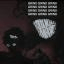
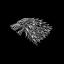
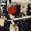

<p align="center"></p>

# OWASP BLT

OWASP BLT (Bug Logging Tool) is a community-driven OWASP Foundation project that develops and maintains open-source tools for structured vulnerability reporting, contributor rewards and security education. Every BLT project lives in this one repository, each in its own folder, with its full commit history.

> **git.owaspblt.org is the official source of truth for BLT.** Please do all work there: clone from it, open
> issues and pull requests there, and discuss there. [github.com/OWASP/BLT](https://github.com/OWASP/BLT) is a
> read-only mirror kept as a backup. It updates automatically, but issues and pull requests aren't accepted on it.

- **Home:** [git.owaspblt.org/BLT](https://git.owaspblt.org/BLT): issues, pull requests and discussions happen here
- **Mirror (read-only backup):** [github.com/OWASP/BLT](https://github.com/OWASP/BLT)
- **Website:** [owaspblt.org](https://owaspblt.org/)

## Getting started

```bash
git clone https://git.owaspblt.org/BLT.git
cd BLT/<project>     # e.g. blt-leaf; each project has its own README
```

Deploy a project with `scripts/deploy.sh <project>`, or every Cloudflare project with `scripts/deploy.sh --all`. See [Deploying](#-deploying).

## Using AI

BLT is a pro-AI project: coding agents and AI assistants are welcome for issues, pull requests, tests and docs. Every BLT issue has a one-line **copy AI prompt** you can paste into your agent to start work. You stay responsible for the result. Before you submit, review every change, run `scripts/ci/test.sh <project>`, and fill in the pull request's **AI model** field (or put `None`). Never paste secrets or private vulnerability details into AI services. Read the full [AI Policy](AI_POLICY.md) before you contribute.

## Contributing and project policies

| | |
|---|---|
| [Contributing](https://git.owaspblt.org/BLT/blob/CONTRIBUTING.md) | Fork, branch and pull request on git.owaspblt.org; tests, commit conventions, [good first issues](https://git.owaspblt.org/BLT/issues?label=good%20first%20issue) |
| [AI Policy](https://git.owaspblt.org/BLT/blob/AI_POLICY.md) | How to use AI tools; every pull request states the AI model used |
| [Security Policy](https://git.owaspblt.org/BLT/blob/SECURITY.md) | Report vulnerabilities privately through the repository's Security tab, never in a public issue |
| [Code of Conduct](https://git.owaspblt.org/BLT/blob/CODE_OF_CONDUCT.md) | The OWASP Code of Conduct applies everywhere BLT works |
| [Support](https://git.owaspblt.org/BLT/blob/SUPPORT.md) | Where to ask questions: issues, discussions, `#project-blt` on the [OWASP Slack](https://owasp.org/slack/invite) |
| [Governance](https://git.owaspblt.org/BLT/blob/GOVERNANCE.md) | Project lead, maintainers, decisions and community leadership elections |
| [License](https://git.owaspblt.org/BLT/blob/LICENSE) | Each project has its own licence; most are AGPL-3.0 |

<!-- PROJECTS-START -->
## 📦 Projects

| Project | What it is | Live site |
|---|---|---|
| [BLT-Action](https://git.owaspblt.org/BLT/BLT-Action) | Issue automation for BLT: /assign and /unassign on git.owaspblt.org issues and the daily release of stale claims (forge workflows), plus the original GitHub Action for other repositories. |  |
| [BLT-API](https://git.owaspblt.org/BLT/BLT-API) | REST API for OWASP BLT, written in Python on Cloudflare Workers: bugs, users, domains, organizations, projects, bug hunts, leaderboards and statistics. | [api.owaspblt.org](https://api.owaspblt.org/) |
| [BLT-Autopatch](https://git.owaspblt.org/BLT/BLT-Autopatch) | Automated patching: proposes fixes for detected security issues. |  |
| [BLT-Byte](https://git.owaspblt.org/BLT/BLT-Byte) | AI-powered assistant for bug bounty hunting and security research on the BLT (Bug Logging Tool) platform. | [byte.owaspblt.org](https://byte.owaspblt.org/) |
| [BLT-CLI](https://git.owaspblt.org/BLT/BLT-CLI) | Terminal (TUI) client for OWASP BLT, written in Rust with Ratatui: browse and triage issues, follow bug hunts and submit vulnerability reports, directly against the BLT API or through BLT-MCP. |  |
| [blt-core](https://git.owaspblt.org/BLT/blt-core) | The main OWASP BLT platform: a Django app for gamified, crowd-sourced bug reporting and vulnerability disclosure across websites, apps and Git repositories. | [owaspblt.org](https://owaspblt.org/) |
| [BLT-Cron](https://git.owaspblt.org/BLT/BLT-Cron) | Cloudflare Worker that holds the account's only cron trigger and runs every BLT Worker's scheduled job on that job's own schedule, through service bindings. |  |
| [BLT-CVE](https://git.owaspblt.org/BLT/BLT-CVE) | Community vulnerability registry under the BLT-YYYY-NNNN namespace, published as static, machine-readable JSON on Cloudflare with no backend. | [cve.owaspblt.org](https://cve.owaspblt.org/) |
| [BLT-Dash](https://git.owaspblt.org/BLT/BLT-Dash) | A company cybersecurity dashboard that integrates with everything and gives a heads-up display single page of everything you need to see. | [dash.owaspblt.org](https://dash.owaspblt.org/) |
| [BLT-Design](https://git.owaspblt.org/BLT/BLT-Design) | Static BLT design system for light/dark mode, logos, colors, typography, and copy-paste component patterns. | [design.owaspblt.org](https://design.owaspblt.org/) |
| [BLT-Design-Contest](https://git.owaspblt.org/BLT/BLT-Design-Contest) | Community design showcase for OWASP BLT. | [contest.owaspblt.org](https://contest.owaspblt.org/) |
| [BLT-Docs](https://git.owaspblt.org/BLT/BLT-Docs) | MkDocs source of the OWASP BLT documentation: user workflows, contributor guidance, API notes and platform maintenance. | [docs.owaspblt.org](https://docs.owaspblt.org/) |
| [BLT-Enforcement](https://git.owaspblt.org/BLT/BLT-Enforcement) | IP and trademark defense tools: trademark name checks and repository comparison for code similarity and license issues. | [enforcement.owaspblt.org](https://enforcement.owaspblt.org/) |
| [BLT-Extension](https://git.owaspblt.org/BLT/BLT-Extension) | Chrome extension that takes screenshots of whole pages or selected areas and adds them to the BLT website. | [extension.owaspblt.org](https://extension.owaspblt.org/) |
| [BLT-Flutter](https://git.owaspblt.org/BLT/BLT-Flutter) | OWASP BLT mobile app in Flutter: report bugs, browse issues and leaderboards, and join bug hunts. | [flutter.owaspblt.org](https://flutter.owaspblt.org/) |
| [BLT-Gitcaster](https://git.owaspblt.org/BLT/BLT-Gitcaster) | Live leaderboard of GitHub repository activity with AI-generated, sportscaster-style commentary on each event. | [gitcaster.owaspblt.org](https://gitcaster.owaspblt.org/) |
| [BLT-GSOC](https://git.owaspblt.org/BLT/BLT-GSOC) | This repository contains the Google Summer of Code (GSoC) pages for the OWASP BLT project, hosted as a static GitHub Pages site. | [gsoc.owaspblt.org](https://gsoc.owaspblt.org/) |
| [BLT-Hackathons](https://git.owaspblt.org/BLT/BLT-Hackathons) | A static hackathon platform for the BLT projects on git.owaspblt.org (and GitHub or GitLab projects) with charts, leaderboards, and prizes. | [hackathons.owaspblt.org](https://hackathons.owaspblt.org/) |
| [BLT-HackerHouse](https://git.owaspblt.org/BLT/BLT-HackerHouse) | Real-time contributor visualization platform for OWASP BLT — now running on Cloudflare Workers. | [hackerhouse.owaspblt.org](https://hackerhouse.owaspblt.org/) |
| [BLT-Home](https://git.owaspblt.org/BLT/BLT-Home) | The owaspblt.org landing page: what OWASP BLT is, live project numbers, every live BLT product, and how to get involved. | [owaspblt.org](https://owaspblt.org/) |
| [BLT-Ideas](https://git.owaspblt.org/BLT/BLT-Ideas) | Brainstorming proposals for future OWASP BLT development, each scoped to one 350-hour project slot; community direction, not commitments. | [ideas.owaspblt.org](https://ideas.owaspblt.org/) |
| [BLT-Jobs](https://git.owaspblt.org/BLT/BLT-Jobs) | Git-native job board for the OWASP BLT ecosystem: job listings and seeker profiles are Markdown files in this folder, published as a static site. | [jobs.owaspblt.org](https://jobs.owaspblt.org/) |
| [BLT-Ketchup](https://git.owaspblt.org/BLT/BLT-Ketchup) | Real-time collaboration workspace for penetration testing teams: shared findings, CVSS scoring, evidence and escalation to BLT. | [ketchup.owaspblt.org](https://ketchup.owaspblt.org/) |
| [BLT-Leaf](https://git.owaspblt.org/BLT/BLT-Leaf) | A simple one-page application to track and monitor GitHub Pull Request readiness status. | [leaf.owaspblt.org](https://leaf.owaspblt.org/) |
| [BLT-Legacy](https://git.owaspblt.org/BLT/BLT-Legacy) | BLT Legacy is the original OWASP BLT Django app (formerly BLT-Core). It is being replaced, feature by feature, by the newer BLT projects. | [legacy.owaspblt.org](https://legacy.owaspblt.org/) |
| [BLT-Lettuce](https://git.owaspblt.org/BLT/BLT-Lettuce) | Slack bot for the OWASP community, running on Cloudflare Workers: welcome messages for new members, project discovery and contributor help. | [lettuce.owaspblt.org](https://lettuce.owaspblt.org/) |
| [BLT-Mayo](https://git.owaspblt.org/BLT/BLT-Mayo) | Read-only Linux security auditing tool (Monitor, Analyze, Yield, Observe) that scans filesystem artifacts for dangerous shell execution and reports explainable findings. |  |
| [BLT-MCP](https://git.owaspblt.org/BLT/BLT-MCP) | MCP (Model Context Protocol) server that gives AI agents and IDEs structured access to OWASP BLT: log bugs, triage issues and query data. | [mcp.owaspblt.org](https://mcp.owaspblt.org/) |
| [BLT-Monitor](https://git.owaspblt.org/BLT/BLT-Monitor) | Website monitor on Cloudflare Python Workers: checks availability and keywords every twenty minutes, keeps recent history in Workers KV and alerts Slack. | [monitor.owaspblt.org](https://monitor.owaspblt.org/) |
| [BLT-NetGuardian](https://git.owaspblt.org/BLT/BLT-NetGuardian) | Signed findings ingest + distributed domain crawl + org triage + BLT convert, on Cloudflare Workers (D1). | [netguardian.owaspblt.org](https://netguardian.owaspblt.org/) |
| [BLT-NetGuardian-Client](https://git.owaspblt.org/BLT/BLT-NetGuardian-Client) | Flutter client for BLT NetGuardian: queue and track security scan tasks, register targets and review discovered vulnerabilities. |  |
| [BLT-Newsletter](https://git.owaspblt.org/BLT/BLT-Newsletter) | OWASP BLT newsletter platform: a Python Cloudflare Worker with D1 storage, an admin dashboard for subscribers and campaigns, and SendGrid delivery. | [newsletter.owaspblt.org](https://newsletter.owaspblt.org/) |
| [BLT-Next](https://git.owaspblt.org/BLT/BLT-Next) | A fresh, modern design by removing non-core components to create a clear, enjoyable user experience focused on core value | [next.owaspblt.org](https://next.owaspblt.org/) |
| [BLT-Nexus](https://git.owaspblt.org/BLT/BLT-Nexus) | Directory of security projects connected to OWASP BLT and the BLT ambassadors who represent them. | [nexus.owaspblt.org](https://nexus.owaspblt.org/) |
| [BLT-OSSH](https://git.owaspblt.org/BLT/BLT-OSSH) | Open-Source Sorting Hat — AI-powered GitHub profile analyzer that recommends perfect open-source projects for contributors. | [ossh.owaspblt.org](https://ossh.owaspblt.org/) |
| [BLT-OWASP-Bumper](https://git.owaspblt.org/BLT/BLT-OWASP-Bumper) | Daily-generated dashboard of every repository in the OWASP GitHub organization, with activity sparklines and project metadata. | [bumper.owaspblt.org](https://bumper.owaspblt.org/) |
| [BLT-OWASP-Metadata](https://git.owaspblt.org/BLT/BLT-OWASP-Metadata) | Collects and standardizes metadata for OWASP projects and chapters from the front matter of their index.md files, with a browsable dashboard. | [metadata.owaspblt.org](https://metadata.owaspblt.org/) |
| [BLT-OWASP-Projects](https://git.owaspblt.org/BLT/BLT-OWASP-Projects) | A static dashboard for tracking OWASP project repositories, repository status, and open issues. | [projects.owaspblt.org](https://projects.owaspblt.org/) |
| [BLT-OWASP-Wich](https://git.owaspblt.org/BLT/BLT-OWASP-Wich) | Browser-based checker that scores a GitHub repository against 100 OWASP compliance points in 10 categories. | [wich.owaspblt.org](https://wich.owaspblt.org/) |
| [BLT-Pages](https://git.owaspblt.org/BLT/BLT-Pages) | Community-powered bug-reporting platform hosted from public/ on Cloudflare, part of the OWASP Bug Logging Tool (BLT) project. | [pages.owaspblt.org](https://pages.owaspblt.org/) |
| [BLT-Panini](https://git.owaspblt.org/BLT/BLT-Panini) | Static site that shows apps banned by countries around the world, as a searchable list and an interactive map. | [panini.owaspblt.org](https://panini.owaspblt.org/) |
| [BLT-Pool](https://git.owaspblt.org/BLT/BLT-Pool) | A GitHub App that integrates OWASP BLT services into GitHub repositories. | [pool.owaspblt.org](https://pool.owaspblt.org/) |
| [BLT-Preflight](https://git.owaspblt.org/BLT/BLT-Preflight) | Advisory tool that gives contributors security guidance and risk notes before they open a pull request; it advises and never blocks. | [preflight.owaspblt.org](https://preflight.owaspblt.org/) |
| [BLT-Profiles](https://git.owaspblt.org/BLT/BLT-Profiles) | Git-native directory of profiles for security professionals, researchers, mentors, students and open-source contributors. | [profiles.owaspblt.org](https://profiles.owaspblt.org/) |
| [BLT-Rewards](https://git.owaspblt.org/BLT/BLT-Rewards) | BACON (Blockchain Assisted Contribution Network): Bitcoin Runes and Solana token rewards for open-source contributions. | [rewards.owaspblt.org](https://rewards.owaspblt.org/) |
| [BLT-SafeCloak](https://git.owaspblt.org/BLT/BLT-SafeCloak) | Privacy-focused peer-to-peer video and voice chat on Cloudflare Workers, with AI-assisted notes and explicit consent management. | [safecloak.owaspblt.org](https://safecloak.owaspblt.org/) |
| [BLT-Sammich](https://git.owaspblt.org/BLT/BLT-Sammich) | Slack bot for the OWASP BLT community: GitHub activity, contributor stats, reminders and project discovery. | [sammich.owaspblt.org](https://sammich.owaspblt.org/) |
| [BLT-Sizzle](https://git.owaspblt.org/BLT/BLT-Sizzle) | Async daily check-ins for organization teams: members post progress and blockers, admins see participation without another meeting. | [sizzle.owaspblt.org](https://sizzle.owaspblt.org/) |
| [BLT-Start](https://git.owaspblt.org/BLT/BLT-Start) | A beautifully designed Contributor Start Page UI for the Bug Logging Tool (BLT) project. | [start.owaspblt.org](https://start.owaspblt.org/) |
| [BLT-Timer-Flutter](https://git.owaspblt.org/BLT/BLT-Timer-Flutter) | Linux desktop activity tracker in Flutter: counts keyboard and mouse activity through a native X11 library and shows live charts and daily summaries, keeping raw input private. |  |
| [BLT-Timer-Web](https://git.owaspblt.org/BLT/BLT-Timer-Web) | BLT Timer Web is a focused web application for recording manual work logs. | [timer.owaspblt.org](https://timer.owaspblt.org/) |
| [BLT-Toasty](https://git.owaspblt.org/BLT/BLT-Toasty) | AI triage and responsible-disclosure assistant for BLT on Cloudflare Workers: redacts PII and secrets, detects duplicate reports and summarizes them. | [toasty.owaspblt.org](https://toasty.owaspblt.org/) |
| [BLT-Tomato](https://git.owaspblt.org/BLT/BLT-Tomato) | OWASP project management scripts and the funding site that lists OWASP projects seeking funding through a funding.yml file. | [tomato.owaspblt.org](https://tomato.owaspblt.org/) |
| [BLT-University](https://git.owaspblt.org/BLT/BLT-University) | Open-source cybersecurity learning site: short courses, browser-based security labs and recent vulnerability data, with progress kept in the browser. | [university.owaspblt.org](https://university.owaspblt.org/) |
| [BLT-Vanish](https://git.owaspblt.org/BLT/BLT-Vanish) | An open-source, hybrid local+edge privacy toolkit for managing and deleting personal data online. | [vanish.owaspblt.org](https://vanish.owaspblt.org/) |
| [BLT-Vanish-Flutter](https://git.owaspblt.org/BLT/BLT-Vanish-Flutter) | The local Flutter application for BLT-Vanish - handles all sensitive personal data locally and encrypted. |  |
| [BLT-Waypoint](https://git.owaspblt.org/BLT/BLT-Waypoint) | Live dashboard of the OWASP BLT projects: commits, issues, pull requests and live site of every folder in this monorepo. | [waypoint.owaspblt.org](https://waypoint.owaspblt.org/) |
| [BLT-Zero](https://git.owaspblt.org/BLT/BLT-Zero) | Zero-Trust Vulnerability Reporting — encrypted payload delivery. | [zero.owaspblt.org](https://zero.owaspblt.org/) |
| [coderabbit](https://git.owaspblt.org/BLT/coderabbit) | Placeholder carried over from the old GitLab group: it holds only a license and has no code or configuration yet. |  |
| [dot_github](https://git.owaspblt.org/BLT/dot_github) | Organization profile README and the scripts that refresh its blog posts and contributor wall. |  |
| [MY-GSOC-TOOL](https://git.owaspblt.org/BLT/MY-GSOC-TOOL) | Dashboard for Google Summer of Code students that gathers their GitHub contributions, blog posts, mentor feedback and milestones on one page. | [gsoc-tool.owaspblt.org](https://gsoc-tool.owaspblt.org/) |
<!-- PROJECTS-END -->

<!-- BLOG-POSTS-START -->
## 📝 Latest Blog Posts

*Last updated: 2026-10-18 10:17 UTC — from [dev.to/owaspblt](https://dev.to/owaspblt)*

<table><tr><td align='center' width='50%'><a href='https://dev.to/owaspblt/eleven-projects-one-remarkable-team-celebrating-owasp-blts-gsoc-2026-4dck'><br><b>Eleven Projects, One Remarkable Team: Celebrating OWASP BLT’s GSoC 2026</b></a></td><td align='center' width='50%'><a href='https://dev.to/owaspblt/my-gsoc-journey-with-owasp-blt-4lm8'><br><b>My GSoC journey with OWASP BLT</b></a></td></tr></table>
<!-- BLOG-POSTS-END -->

<!-- CONTRIBUTORS-START -->
## 👥 Contributors (274 total)

*Last updated: 2026-10-21 22:49 UTC — everyone with a commit in any BLT project, authors and co-authors, bots excluded (1 on git.owaspblt.org, 244 on GitHub, 29 by commit name only). Avatars and the full list live in [`.forkmesh/contributors`](.forkmesh/contributors/contributors.json).*

<a href="https://git.owaspblt.org/@DonnieBLT" title="DonnieBLT: 3732 commits"></a> <a href="https://github.com/Nachiket-Roy" title="Nachiket Roy (@Nachiket-Roy): 724 commits"></a> <a href="https://github.com/mdkaifansari04" title="Md Kaif Ansari (@mdkaifansari04): 434 commits"></a>   <a href="https://github.com/Pritz395" title="preetham (@Pritz395): 276 commits"></a> <a href="https://github.com/JisanAR03" title="Altafur Rahman (@JisanAR03): 248 commits"></a> <a href="https://github.com/Jayant2908" title="Jayant Malvi (@Jayant2908): 165 commits"></a> <a href="https://github.com/S3DFX-CYBER" title="Savio Dsouza (@S3DFX-CYBER): 164 commits"></a> <a href="https://github.com/Sarthak5598" title="Sarthak5598: 155 commits"></a> <a href="https://github.com/arnavkirti" title="Arnav Kirti (@arnavkirti): 142 commits"></a> <a href="https://github.com/e-esakman" title="Sakshee Suman (@e-esakman): 142 commits"></a> <a href="https://github.com/AtmegaBuzz" title="swapnil shinde (@AtmegaBuzz): 140 commits"></a> <a href="https://github.com/sidd190" title="Siddharth Bansal (@sidd190): 131 commits"></a> <a href="https://github.com/mohitanand001" title="Mohit Anand (@mohitanand001): 120 commits"></a> <a href="https://github.com/ojaswa072" title="Ojaswa . (@ojaswa072): 118 commits"></a> <a href="https://github.com/jajodiaraghav" title="Raghav Jajodia (@jajodiaraghav): 91 commits"></a> <a href="https://github.com/yashhzd" title="Yash Goel (@yashhzd): 91 commits"></a> <a href="https://github.com/ananya-in-tech" title="Ananya (@ananya-in-tech): 89 commits"></a> <a href="https://github.com/rinkitadhana" title="Rinkit Adhana (@rinkitadhana): 86 commits"></a> <a href="https://github.com/krrish-sehgal" title="Krrish Sehgal (@krrish-sehgal): 82 commits"></a> <a href="https://github.com/souravbadami" title="Sourav Badami (@souravbadami): 73 commits"></a> <a href="https://github.com/CodeWithBishal" title="Bishal Das (@CodeWithBishal): 71 commits"></a> <a href="https://github.com/Rudra-rps" title="Rudra (@Rudra-rps): 68 commits"></a> <a href="https://github.com/aryanghai12" title="Aryan Ghai (@aryanghai12): 61 commits"></a> <a href="https://github.com/letsintegreat" title="Harshit Seksaria (@letsintegreat): 58 commits"></a> <a href="https://github.com/srahulbadami" title="S Rahul Badami (@srahulbadami): 58 commits"></a> <a href="https://github.com/Kunal241207" title="Kunal241207: 57 commits"></a> <a href="https://github.com/igennova" title="Lucky negi (@igennova): 53 commits"></a> <a href="https://github.com/tejeshvenkat" title="Tejeshvenkat: 52 commits"></a> <a href="https://github.com/SahilDhillon21" title="Sahil Omkumar Dhillon (@SahilDhillon21): 51 commits"></a> <a href="https://github.com/Shhazzz" title="Shaz Zahra Zaidi (@Shhazzz): 48 commits"></a> <a href="https://github.com/swaparup36" title="Swaparup Mukherjee (@swaparup36): 45 commits"></a>  <a href="https://github.com/Uttkarsh-raj" title="Uttkarsh-raj: 43 commits"></a> <a href="https://github.com/gojo-satorou-v7" title="Abhishek Kumar (@gojo-satorou-v7): 42 commits"></a> <a href="https://github.com/arkid15r" title="Arkadii Yakovets (@arkid15r): 42 commits"></a> <a href="https://github.com/AdityaGupta716" title="Aditya Gupta (@AdityaGupta716): 35 commits"></a> <a href="https://github.com/sid22" title="Siddharth Goyal (@sid22): 34 commits"></a> <a href="https://github.com/haroon0x" title="Haroon (@haroon0x): 33 commits"></a> <a href="https://github.com/azizrebhi" title="azizrebhi: 32 commits"></a> <a href="https://github.com/tsu-ki" title="Krishna Kaushal (@tsu-ki): 32 commits"></a>  <a href="https://github.com/justary27" title="Aryan Ranjan (@justary27): 30 commits"></a> <a href="https://github.com/ankit2001" title="Ankit Choudhary (@ankit2001): 29 commits"></a> <a href="https://github.com/HanilJain" title="H4N1L (@HanilJain): 29 commits"></a> <a href="https://github.com/Jozz77" title="Jonathan Mmadu (@Jozz77): 29 commits"></a> <a href="https://github.com/Roboneet" title="Neethu Mariya Joy (@Roboneet): 29 commits"></a> <a href="https://github.com/stealthwhizz" title="Amogh Sunil (@stealthwhizz): 28 commits"></a> <a href="https://github.com/SatishKumar620" title="satishkumar620: 27 commits"></a> <a href="https://github.com/SomyaBaran" title="SomyaBaran: 27 commits"></a> <a href="https://github.com/Manahil-Afzal" title="Manahil Afzal (@Manahil-Afzal): 24 commits"></a> <a href="https://github.com/nitinawari" title="Nitin Awari (@nitinawari): 24 commits"></a> <a href="https://github.com/solo-daemon" title="Amrit Prakash (@solo-daemon): 23 commits"></a>  <a href="https://github.com/errorassassin" title="Pulkit Agrawal (@errorassassin): 23 commits"></a> <a href="https://github.com/Rudrawhy" title="Rudra (@Rudrawhy): 22 commits"></a> <a href="https://github.com/DevalPrime" title="Deval Prime (@DevalPrime): 19 commits"></a>   <a href="https://github.com/drvcodenta" title="Dhruv Trivedi (@drvcodenta): 16 commits"></a> <a href="https://github.com/karunarapolu" title="Karuna Rapolu (@karunarapolu): 16 commits"></a> <a href="https://github.com/Ontiomacer" title="Ontiomacer: 16 commits"></a> <a href="https://github.com/snigdhachoudhury" title="snigdha choudhury (@snigdhachoudhury): 16 commits"></a> <a href="https://github.com/YASHvardhanVashistha" title="Yashvardhan Vashistha (@YASHvardhanVashistha): 16 commits"></a>  <a href="https://github.com/thedudeontitan" title="Ankit Kokane (@thedudeontitan): 14 commits"></a> <a href="https://github.com/aprv10" title="Apoorv Singh (@aprv10): 14 commits"></a>  <a href="https://github.com/Tia-ani" title="Anishka Khurana (@Tia-ani): 13 commits"></a> <a href="https://github.com/Ankitsinghsisodya" title="Ankitsinghsisodya: 13 commits"></a> <a href="https://github.com/co-decode" title="Cody Ross (@co-decode): 13 commits"></a> <a href="https://github.com/Prakhar-Shankar" title="Prakhar-Shankar: 13 commits"></a> <a href="https://github.com/codeXanu" title="Anuj Maurya (@codeXanu): 12 commits"></a> <a href="https://github.com/Sparsh1212" title="Sparsh Agrawal (@Sparsh1212): 12 commits"></a> <a href="https://github.com/apoorvapendse" title="Apoorva Pendse (@apoorvapendse): 11 commits"></a>  <a href="https://github.com/Ankit-singh-dot" title="Ankit (@Ankit-singh-dot): 10 commits"></a> <a href="https://github.com/razzasid" title="Raza Siddique (@razzasid): 10 commits"></a> <a href="https://github.com/Himanshu-639" title="Himanshu Yadav (@Himanshu-639): 9 commits"></a> <a href="https://github.com/Dante291" title="Parag Gupta (@Dante291): 9 commits"></a> <a href="https://github.com/Preetam-77" title="preetan bannenavar (@Preetam-77): 9 commits"></a> <a href="https://github.com/ATHARVA-GAWAS" title="ATHARVA-GAWAS: 8 commits"></a> <a href="https://github.com/Saurabhyadav0" title="saurabhyadav0: 8 commits"></a> <a href="https://github.com/snk-git-hub" title="Shivanandu (@snk-git-hub): 8 commits"></a> <a href="https://github.com/Shubhangpathak" title="Shubhangpathak: 8 commits"></a> <a href="https://github.com/Tejas-Ladhani" title="Tejas Ladhani (@Tejas-Ladhani): 8 commits"></a> <a href="https://github.com/kr-2003" title="Abhinav Kumar (@kr-2003): 7 commits"></a> <a href="https://github.com/kittenbytes" title="kittenbytes: 7 commits"></a> <a href="https://github.com/manikandanchandran" title="Manikandan Chandran (@manikandanchandran): 7 commits"></a> <a href="https://github.com/spiderxm" title="Mrigank Anand (@spiderxm): 7 commits"></a> <a href="https://github.com/shiva119127" title="shivam Singh (@shiva119127): 7 commits"></a> <a href="https://github.com/Yajush-afk" title="Yajush-afk: 7 commits"></a> <a href="https://github.com/TonyStark-19" title="Aditya chandel (@TonyStark-19): 6 commits"></a> <a href="https://github.com/ANIRUDH-SJ" title="ANIRUDH-SJ: 6 commits"></a> <a href="https://github.com/dhruv7539" title="dhruv7539: 6 commits"></a> <a href="https://github.com/rahulnegi20" title="Rahul Negi (@rahulnegi20): 6 commits"></a> <a href="https://github.com/cicada0007" title="sath000007 (@cicada0007): 6 commits"></a> <a href="https://github.com/ShreyashBRN" title="ShreyashBRN: 6 commits"></a> <a href="https://github.com/hurrrsh" title="Harsh Natuskar (@hurrrsh): 5 commits"></a> <a href="https://github.com/c0d3h01" title="Harshal Sawant (@c0d3h01): 5 commits"></a> <a href="https://github.com/MattSilverio" title="Matheus Phillipo (@MattSilverio): 5 commits"></a> <a href="https://github.com/Nishat30" title="nishat30: 5 commits"></a> <a href="https://github.com/samyak003" title="Samyak (@samyak003): 5 commits"></a> <a href="https://github.com/Sumit6307" title="Sumit Kesarwani (@Sumit6307): 5 commits"></a> <a href="https://github.com/pixawna" title="0xBhawna (@pixawna): 4 commits"></a> <a href="https://github.com/Abhinavexists" title="Abhinav (@Abhinavexists): 4 commits"></a>  <a href="https://github.com/happypeepo" title="happypeepo: 4 commits"></a> <a href="https://github.com/Kej-r03" title="Kej-r03: 4 commits"></a> <a href="https://github.com/Krishiv-Mahajan" title="Krishiv Mahajan (@Krishiv-Mahajan): 4 commits"></a> <a href="https://github.com/0xmanthan" title="Manthan Sharma (@0xmanthan): 4 commits"></a> <a href="https://github.com/nikhil25803" title="Nikhil Raj (@nikhil25803): 4 commits"></a> <a href="https://github.com/ramansh18" title="ramansh18: 4 commits"></a> <a href="https://github.com/Riya-Jain-here" title="Riya (@Riya-Jain-here): 4 commits"></a> <a href="https://github.com/rtgdk" title="Rohit Lodha (@rtgdk): 4 commits"></a> <a href="https://github.com/skyvanguard" title="skyvanguard: 4 commits"></a>  <a href="https://github.com/adimail" title="Aditya (@adimail): 3 commits"></a> <a href="https://github.com/aimaanayaz" title="aimaan-ayaz (@aimaanayaz): 3 commits"></a> <a href="https://github.com/Chaimaekit" title="Chaimaekit: 3 commits"></a> <a href="https://github.com/daemon-reconfig" title="Daemon (@daemon-reconfig): 3 commits"></a> <a href="https://github.com/Elysia1104" title="Ely (@Elysia1104): 3 commits"></a> <a href="https://github.com/gayathri2006-cmd" title="gayathri2006-cmd: 3 commits"></a> <a href="https://github.com/JigyasuRajput" title="JigyasuRajput: 3 commits"></a> <a href="https://github.com/ManishBisht777" title="Manish Bisht (@ManishBisht777): 3 commits"></a> <a href="https://github.com/Neurvinch" title="Naveen pandian (@Neurvinch): 3 commits"></a> <a href="https://github.com/sagnik3788" title="Sagnik Das (@sagnik3788): 3 commits"></a>  <a href="https://github.com/vanshika2720" title="Vanshika (@vanshika2720): 3 commits"></a>  <a href="https://github.com/vidipsingh" title="Vidip Singh (@vidipsingh): 3 commits"></a>  <a href="https://github.com/yadneshx17" title="Yadnesh Tambe (@yadneshx17): 3 commits"></a> <a href="https://github.com/YasogaN" title="Yasoga Nanayakkarawasam (@YasogaN): 3 commits"></a> <a href="https://github.com/01luyicheng" title="01luyicheng: 2 commits"></a> <a href="https://github.com/abhayguptas" title="Abhay Kumar Gupta (@abhayguptas): 2 commits"></a>  <a href="https://github.com/btwshivam" title="btwshivam: 2 commits"></a> <a href="https://github.com/charlieamadeus" title="charlieamadeus: 2 commits"></a> <a href="https://github.com/Gurleen-kansray" title="Gurleen-kansary (@Gurleen-kansray): 2 commits"></a> <a href="https://github.com/harsh3dev" title="Harsh Pandey (@harsh3dev): 2 commits"></a> <a href="https://github.com/Deus1704" title="Jayraj Dulange (@Deus1704): 2 commits"></a> <a href="https://github.com/KapilSareen" title="Kapil Sareen (@KapilSareen): 2 commits"></a> <a href="https://github.com/Kaushik-Shahare" title="Kaushik Shahare (@Kaushik-Shahare): 2 commits"></a> <a href="https://github.com/khushal-winner" title="Khushal Malhotra (@khushal-winner): 2 commits"></a> <a href="https://github.com/koushikmahadev" title="Koushik M (@koushikmahadev): 2 commits"></a> <a href="https://github.com/kris70lesgo" title="kris70lesgo: 2 commits"></a> <a href="https://github.com/Kunal1522" title="Kunal1522: 2 commits"></a> <a href="https://github.com/Makeepan-dev" title="Makeepan Thanarasa (@Makeepan-dev): 2 commits"></a> <a href="https://github.com/MohammedAnasNathani" title="Mohammed Anas Nathani (@MohammedAnasNathani): 2 commits"></a> <a href="https://github.com/mujeeb-mughal1" title="mujeeb-mughal1: 2 commits"></a> <a href="https://github.com/nytrixis" title="Nandini Pandey (@nytrixis): 2 commits"></a> <a href="https://github.com/nileshpahari" title="Nilesh Pahari (@nileshpahari): 2 commits"></a> <a href="https://github.com/npxpatel" title="Nirajkumar Patel (@npxpatel): 2 commits"></a> <a href="https://github.com/Norhan-Gamal25" title="Norhan (@Norhan-Gamal25): 2 commits"></a> <a href="https://github.com/MrImmortal09" title="Om Swami (@MrImmortal09): 2 commits"></a> <a href="https://github.com/ordersys" title="ordersys: 2 commits"></a> <a href="https://github.com/rafen" title="rafen: 2 commits"></a> <a href="https://github.com/rimjhim-codes" title="Rimjhim Kumari (@rimjhim-codes): 2 commits"></a> <a href="https://github.com/snowkluster" title="Rohan Kaushik (@snowkluster): 2 commits"></a> <a href="https://github.com/RudraBhaskar9439" title="Rudra Bhaskar (@RudraBhaskar9439): 2 commits"></a> <a href="https://github.com/SamrithaShree" title="SamrithaShree: 2 commits"></a> <a href="https://github.com/sarafarajnasardi" title="Sarafaraj Nasardi (@sarafarajnasardi): 2 commits"></a> <a href="https://github.com/sharanyaa30" title="Sharanyaa G (@sharanyaa30): 2 commits"></a> <a href="https://github.com/shubham-200315" title="Shubham Jaiswal (@shubham-200315): 2 commits"></a> <a href="https://github.com/devSuryansh" title="Suryansh Singh (@devSuryansh): 2 commits"></a> <a href="https://github.com/tarachris" title="tarachris: 2 commits"></a>  <a href="https://github.com/dotnetdork" title="Voidoid1977 (@dotnetdork): 2 commits"></a>  <a href="https://github.com/Aarush289" title="Aarush289: 1 commit"></a> <a href="https://github.com/Aashik1701" title="Aashik1701: 1 commit"></a> <a href="https://github.com/nasredeenabdulhaleem" title="Abdulhaleem Nasredeen Hamza (@nasredeenabdulhaleem): 1 commit"></a> <a href="https://github.com/abelradac" title="abel (@abelradac): 1 commit"></a> <a href="https://github.com/AgentGoose32" title="AgentGoose32: 1 commit"></a> <a href="https://github.com/elsheikh21" title="Ahmed ElSheikh (@elsheikh21): 1 commit"></a> <a href="https://github.com/akankshsinhaa" title="akankshsinhaa: 1 commit"></a> <a href="https://github.com/Captain-T2004" title="Akshay Behl (@Captain-T2004): 1 commit"></a> <a href="https://github.com/amulya888" title="Amulya singh (@amulya888): 1 commit"></a> <a href="https://github.com/Ananyasingh2002" title="Ananya Singh (@Ananyasingh2002): 1 commit"></a> <a href="https://github.com/anukalp2804" title="Anukalp (@anukalp2804): 1 commit"></a> <a href="https://github.com/Ai-chan-0411" title="aoi-dev-0411 (@Ai-chan-0411): 1 commit"></a> <a href="https://github.com/gitsofaryan" title="Aryan Jain (@gitsofaryan): 1 commit"></a> <a href="https://github.com/Aryanbhargava18" title="Aryanbhargava18: 1 commit"></a> <a href="https://github.com/AB527" title="Atharva Bedekar (@AB527): 1 commit"></a>  <a href="https://github.com/vamshi567bh" title="bharath (@vamshi567bh): 1 commit"></a> <a href="https://github.com/vanta722" title="Calstrom White (@vanta722): 1 commit"></a> <a href="https://github.com/Cypher-CP0" title="Cypher-CP0: 1 commit"></a> <a href="https://github.com/dev-sanidhya" title="dev-sanidhya: 1 commit"></a> <a href="https://github.com/DevvoZA" title="DevvoZA: 1 commit"></a> <a href="https://github.com/dRaniwal" title="Dhairya Raniwal (@dRaniwal): 1 commit"></a> <a href="https://github.com/dhruvkrishnavaid" title="Dhruv Krishna Vaid (@dhruvkrishnavaid): 1 commit"></a> <a href="https://github.com/mystic-06" title="Dhruv Sharma (@mystic-06): 1 commit"></a> <a href="https://github.com/Draxilion" title="Draxilion: 1 commit"></a> <a href="https://github.com/Mohammedfaiyaz29" title="faiyaz shaikh (@Mohammedfaiyaz29): 1 commit"></a> <a href="https://github.com/CloudFaye" title="Faye seun (@CloudFaye): 1 commit"></a> <a href="https://github.com/filipkov04" title="Filip Vrablik (@filipkov04): 1 commit"></a> <a href="https://github.com/devrobbin" title="fzrobbin (@devrobbin): 1 commit"></a> <a href="https://github.com/DrGalio" title="Galio (Demaciains) (@DrGalio): 1 commit"></a> <a href="https://github.com/gauravloj" title="Gaurav Vijayvargia (@gauravloj): 1 commit"></a> <a href="https://github.com/giftidris4-spec" title="giftidris4-spec: 1 commit"></a> <a href="https://github.com/gitcuber369" title="gitcuber (@gitcuber369): 1 commit"></a> <a href="https://github.com/gomgam" title="gomgam: 1 commit"></a> <a href="https://github.com/hsay123" title="hsay123: 1 commit"></a> <a href="https://github.com/Iloveshe" title="Iloveshe: 1 commit"></a> <a href="https://github.com/iitzIrFan" title="Irfan (@iitzIrFan): 1 commit"></a> <a href="https://github.com/Izhaan60" title="Izhan (@Izhaan60): 1 commit"></a> <a href="https://github.com/JessCode-TheRedumption" title="jeswinstanly9 (@JessCode-TheRedumption): 1 commit"></a> <a href="https://github.com/JitPatro" title="JitPatro: 1 commit"></a> <a href="https://github.com/mkamrul9" title="kamrul (@mkamrul9): 1 commit"></a>  <a href="https://github.com/krauzX" title="krauzX: 1 commit"></a> <a href="https://github.com/Manice18" title="Manice18: 1 commit"></a> <a href="https://github.com/Mberic" title="Mberic: 1 commit"></a> <a href="https://github.com/MrunalrajRedij" title="Mrunalraj (@MrunalrajRedij): 1 commit"></a> <a href="https://github.com/officialarmannqureshi" title="Nazim (@officialarmannqureshi): 1 commit"></a> <a href="https://github.com/Neel-Pandya" title="Neel Pandya (@Neel-Pandya): 1 commit"></a> <a href="https://github.com/space-techy" title="Nikhil B Patil (@space-techy): 1 commit"></a> <a href="https://github.com/nithinskumar866" title="nithinskumar866: 1 commit"></a> <a href="https://github.com/Olli-Dev" title="Olli í Lágabø (@Olli-Dev): 1 commit"></a> <a href="https://github.com/one-kash" title="one-kash: 1 commit"></a> <a href="https://github.com/Nitish-Naik" title="P Nitish (@Nitish-Naik): 1 commit"></a> <a href="https://github.com/pawankalhansh" title="Pawan Kumar Singh (@pawankalhansh): 1 commit"></a> <a href="https://github.com/phiphuc" title="phiphuc: 1 commit"></a> <a href="https://github.com/Piyushrathoree" title="Piyushrathoree: 1 commit"></a>  <a href="https://github.com/Prachi9506" title="Prachi9506: 1 commit"></a> <a href="https://github.com/agarwalpranav0711" title="Pranav Agarwal (@agarwalpranav0711): 1 commit"></a> <a href="https://github.com/pranav-leo" title="Pranav Arya (@pranav-leo): 1 commit"></a> <a href="https://github.com/psamuelvijay" title="psamuelvijay: 1 commit"></a> <a href="https://github.com/py-huang" title="py-huang: 1 commit"></a> <a href="https://github.com/Rancho-rachit" title="Rachit Agrawal (@Rancho-rachit): 1 commit"></a> <a href="https://github.com/Rafael-gc" title="Rafael-gc: 1 commit"></a> <a href="https://github.com/Raj-chatarmin" title="Raj (@Raj-chatarmin): 1 commit"></a> <a href="https://github.com/Rajgupta36" title="Raj gupta (@Rajgupta36): 1 commit"></a> <a href="https://github.com/ratiruhela9" title="ratiruhela9: 1 commit"></a> <a href="https://github.com/Rcloudso" title="Rcloudso: 1 commit"></a>  <a href="https://github.com/Rishab87" title="Rishab87: 1 commit"></a> <a href="https://github.com/RedK22" title="Ritwik Kapoor (@RedK22): 1 commit"></a> <a href="https://github.com/Samarth1907" title="Samarth1907: 1 commit"></a>   <a href="https://github.com/itSarthak" title="Sarthak Tyagi (@itSarthak): 1 commit"></a> <a href="https://github.com/Pandey-SaurabhP" title="Saurabh Pandey (@Pandey-SaurabhP): 1 commit"></a>  <a href="https://github.com/Shashwat-srivastav" title="Shashwat srivastava (@Shashwat-srivastav): 1 commit"></a> <a href="https://github.com/shriyashsoni" title="Shriyash soni (@shriyashsoni): 1 commit"></a> <a href="https://github.com/Shushmitaaaa" title="Shushmita (@Shushmitaaaa): 1 commit"></a> <a href="https://github.com/Varshith2403315" title="Siva Sai Varshith (@Varshith2403315): 1 commit"></a> <a href="https://github.com/yashspidey" title="spidey279 (@yashspidey): 1 commit"></a> <a href="https://github.com/srinitha709" title="srinitha tirunagari (@srinitha709): 1 commit"></a> <a href="https://github.com/srinithivijayakumars139-wq" title="srinithivijayakumars139-wq: 1 commit"></a> <a href="https://github.com/Sriram-B-Srivatsa" title="SriramB (@Sriram-B-Srivatsa): 1 commit"></a> <a href="https://github.com/sudhirpal" title="sudhirpal: 1 commit"></a> <a href="https://github.com/SwastikKaushal1" title="swastik (@SwastikKaushal1): 1 commit"></a>  <a href="https://github.com/TacticalPrice" title="Ujjwal (@TacticalPrice): 1 commit"></a>  <a href="https://github.com/varora02" title="varora02: 1 commit"></a> <a href="https://github.com/1010varun" title="Varun Agarwal (@1010varun): 1 commit"></a> <a href="https://github.com/VedantAnand17" title="VedantAnand17: 1 commit"></a> <a href="https://github.com/Vineetttt" title="Vineet Chotaliya (@Vineetttt): 1 commit"></a> <a href="https://github.com/singhvishalkr" title="Vishal Kumar Singh (@singhvishalkr): 1 commit"></a> <a href="https://github.com/wcj007" title="wcj007: 1 commit"></a> <a href="https://github.com/willkhinz" title="willkhinz: 1 commit"></a> <a href="https://github.com/wuchiwuchi" title="wuchiwuchi: 1 commit"></a> <a href="https://github.com/Yashsomalkar" title="Yashsomalkar: 1 commit"></a>  <a href="https://github.com/Noobmaster69-san" title="zen (@Noobmaster69-san): 1 commit"></a> <a href="https://github.com/zp6" title="zp6: 1 commit"></a> 
<!-- CONTRIBUTORS-END -->

<!-- DEPLOY-START -->
## 🚀 Deploying

Every Cloudflare project deploys from its own folder. Set `CLOUDFLARE_API_TOKEN` and `CLOUDFLARE_ACCOUNT_ID`, then:

```bash
scripts/deploy.sh blt-leaf            # one project
scripts/deploy.sh blt-leaf blt-api    # several
scripts/deploy.sh --all               # everything
scripts/deploy.sh --all --dry-run     # build and validate only
```

Secrets are set per Worker with `wrangler secret put` (see each project's README).

| Project | Folder | Deploy type | Cloudflare name | Crons |
|---|---|---|---|---|
| blt-action | `blt-action/` | worker | blt-action |  |
| blt-api | `blt-api/` | worker | blt-api |  |
| blt-autopatch | `blt-autopatch/` | worker | blt-autopatch |  |
| blt-byte | `blt-byte/` | pywrangler | blt-byte |  |
| blt-cli | `blt-cli/` | worker | blt-cli |  |
| blt-cve | `blt-cve/` | worker | blt-cve |  |
| blt-dash | `blt-dash/` | worker | blt-dash |  |
| blt-design-contest | `blt-design-contest/` | worker | blt-contest |  |
| blt-design | `blt-design/` | worker | blt-design |  |
| blt-docs | `blt-docs/` | worker | blt-docs |  |
| blt-enforcement | `blt-enforcement/` | worker | blt-enforcement |  |
| blt-extension | `blt-extension/` | worker | blt-extension |  |
| blt-flutter | `blt-flutter/` | worker | blt-flutter |  |
| blt-gitcaster | `blt-gitcaster/` | worker | blt-gitcaster |  |
| blt-gsoc | `blt-gsoc/` | worker | blt-gsoc |  |
| blt-hackathons | `blt-hackathons/` | worker | blt-hackathons |  |
| blt-hackerhouse | `blt-hackerhouse/` | pywrangler | hackerhouse |  |
| blt-home | `blt-home/` | worker | blt-home |  |
| blt-ideas | `blt-ideas/` | worker | blt-ideas |  |
| blt-jobs | `blt-jobs/` | worker | blt-jobs |  |
| blt-ketchup | `blt-ketchup/` | worker | blt-ketchup |  |
| blt-leaf | `blt-leaf/` | worker | blt-leaf |  |
| blt-lettuce | `blt-lettuce/` | worker | blt-lettuce |  |
| blt-mayo | `blt-mayo/` | worker | blt-mayo |  |
| blt-mcp | `blt-mcp/` | worker | blt-mcp |  |
| blt-monitor | `blt-monitor/` | worker | blt-monitor |  |
| blt-netguardian | `blt-netguardian/` | worker | blt-netguardian |  |
| blt-newsletter | `blt-newsletter/` | worker | blt-newsletter |  |
| blt-next | `blt-next/` | worker | blt-next |  |
| blt-nexus | `blt-nexus/` | worker | blt-nexus |  |
| blt-ossh | `blt-ossh/` | worker | blt-ossh |  |
| blt-owasp-bumper | `blt-owasp-bumper/` | worker | blt-owasp-bumper |  |
| blt-owasp-metadata | `blt-owasp-metadata/` | worker | blt-owasp-metadata |  |
| blt-owasp-projects | `blt-owasp-projects/` | worker | blt-owasp-projects |  |
| blt-owasp-wich | `blt-owasp-wich/` | worker | blt-owasp-wich |  |
| blt-pages | `blt-pages/` | worker | blt-pages |  |
| blt-panini | `blt-panini/` | worker | blt-panini |  |
| blt-pool | `blt-pool/` | worker | blt-github-app |  |
| blt-preflight | `blt-preflight/` | worker | blt-preflight |  |
| blt-profiles | `blt-profiles/` | worker | blt-profiles |  |
| blt-rewards | `blt-rewards/` | worker | blt-rewards |  |
| blt-safecloak | `blt-safecloak/` | worker | blt-safecloak |  |
| blt-sammich | `blt-sammich/` | worker | blt-sammich |  |
| blt-sizzle | `blt-sizzle/` | script `./deploy.sh` | blt-sizzle |  |
| blt-start | `blt-start/` | worker | blt-start |  |
| blt-timer-web | `blt-timer-web/` | script `./deploy.sh` | blt-timer |  |
| blt-toasty | `blt-toasty/` | worker | blt-toasty |  |
| blt-tomato | `blt-tomato/` | worker | blt-tomato |  |
| blt-university | `blt-university/` | worker | blt-university |  |
| blt-waypoint | `blt-waypoint/` | worker | blt-waypoint |  |
| blt-zero | `blt-zero/` | worker | blt-zero |  |
| my-gsoc-tool | `my-gsoc-tool/` | worker | my-gsoc-tool |  |
| blt-vanish | `blt-vanish/cloudflare_workers/` | worker | blt-vanish |  |
| blt-cron | `blt-cron/` | worker | blt-cron | `* * * * *` |
<!-- DEPLOY-END -->

CI, scheduled data refreshes, issue automation and deploys run as ForkMesh Actions from `.forkmesh/`; see [docs/workflows.md](docs/workflows.md) for every workflow, its schedule and the secrets it needs.

## License

There is no single licence for the whole repository: each project keeps its own `LICENSE` file in its folder, and
that file applies. Most projects are AGPL-3.0; `blt-leaf` is MIT and `blt-lettuce` is GPL-3.0, and a few folders have
no licence file yet. See the root [LICENSE](https://git.owaspblt.org/BLT/blob/LICENSE) notice for the list.

<sub>The Projects and Contributors sections are generated by `scripts/readme/update_readme.py`.</sub>
