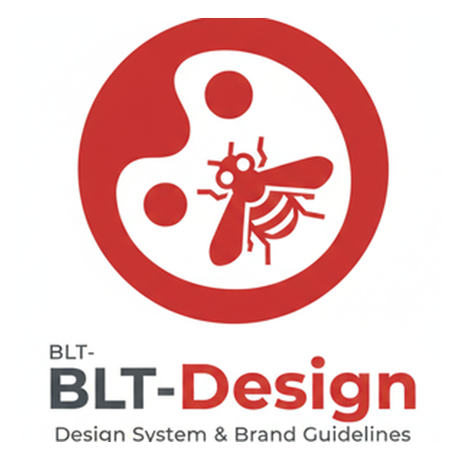

# BLT-Design

**Live Site:** [https://design.owaspblt.org/](https://design.owaspblt.org/)<br>
**Source Code:** [https://git.owaspblt.org/BLT/BLT-Design](https://git.owaspblt.org/BLT/BLT-Design)

<p align="center"></p>

Static BLT design system for light/dark mode, logos, colors, typography, and copy-paste component patterns.

## Cloudflare Pages

This repository is configured as a static Cloudflare Pages site. The deployable
site lives in the repository root, so no build step or generated output folder
is needed.

For a Git-connected Pages project, use:

- Build command: leave blank
- Build output directory: `.`
- Root directory: leave blank

To preview or deploy with Wrangler:

```bash
npx wrangler pages dev
npx wrangler pages deploy
```

The custom domain is recorded in `CNAME` as `design.owaspblt.org`. Add the same
domain in the Cloudflare Pages dashboard after creating the project.

## Preview

Serve the folder with any local static server, then open `index.html`. The guide is static HTML with Tailwind CDN, Font Awesome CDN, and local shared assets.

```bash
python3 -m http.server 8765
```

Open `http://127.0.0.1:8765/index.html`. Do not use `file://` directly, because the shared sidebar is loaded from a local HTML partial.

## Theme

- Shared CSS: `docs/assets/css/blt-design.css`
- Shared theme script: `docs/assets/js/theme.js`
- Dark mode uses the `dark` class on `<html>`.
- Theme preference is stored in `localStorage` under `theme` (`dark` / `light`), the same key every BLT site
  uses; the old `blt-theme` key is read once as a fallback.
- Every page loads the shared OWASP BLT top bar (`https://owaspblt.org/_shared/blt-nav.js`), which has the
  theme toggle. It is the guide's only header: `<blt-nav project="blt-design" name="Design" data-sticky>`
  first in `<body>` carries the guide's sections (Overview, Foundations, Components, Logos) and its
  Preview / Contribute buttons. The docs sidebar sits under it (sticky at `top: 62px`, wide screens only).
  The Navbar page (`docs/components/navbar.html`) documents this one-header pattern for every BLT site.

## Component Coverage

The guide now covers the core BLT library:

- Shell: navbar, BLT sidebar, cards
- Controls: buttons, inputs, search, links, tabs
- Feedback: badges, alerts, modals, states
- Data and assets: tables, icons, repository logos

Every page should include the shared CSS and theme script, show a preview, and keep examples copy-paste friendly for BLT auth, cloud, reports, domains, contributors, and issue workflows.

## Design Direction

The guide matches the owaspblt.org homepage:

- Primary red: `#dc2626` (red-600); hover `#b91c1c` (red-700); dark-mode accent red-400/500
- Surfaces: neutral Tailwind grays (white / gray-50 light; gray-950 page, gray-900 cards dark)
- Borders: gray-200 light, gray-800 dark (never white in dark mode)
- Cards: rounded-2xl
- UI font: the system font stack; code: `ui-monospace, SFMono-Regular, Menlo, Monaco, Consolas, monospace`
- Brand mark: the OWASP wasp is the primary OWASP BLT mark; the old red circle mark is secondary/legacy
- Logos: sites show logos from SVG sources; rasters only where a platform requires them (favicon.ico,
  app icons, extension manifest PNGs, og:image)

Keep new pages token-driven and copy-paste friendly.
