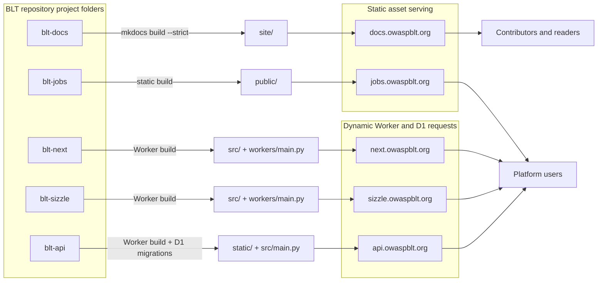

# BLT platform architecture

## Purpose

This page describes the documentation-level architecture view for contributors. It explains how major BLT modules relate to each other without replacing repository-owned architecture documents, implementation notes, or deployment runbooks.

## Deployment patterns

BLT's active services follow four proven deployment patterns. Each pattern names its owning repository, what it builds, and its ownership boundary.

| Pattern | Owner | Output | Boundary |
| ------- | ----- | ------ | -------- |
| Static documentation | BLT-docs | `mkdocs build --strict` generates `site/`, served by Cloudflare Workers Static Assets with no Worker code. | BLT-docs owns the documentation map and cross-project architecture. It does not run application code. |
| Git-native static content | BLT-Jobs | Static assets served directly from `./public`; the `wrangler.toml` has no `main` entry point or Python Worker. | BLT-Jobs owns job and community portal content as versioned files, plus its own publishing workflow. |
| Hybrid Worker application | BLT-Next, BLT-Sizzle | Static assets plus a Python Cloudflare Worker (`python_workers` compatibility flag) handling dynamic routes. BLT-Sizzle additionally persists to D1 and runs a scheduled cron trigger. | Each repository owns its Worker code, routes, and, for BLT-Sizzle, its D1 schema, migrations, and reminder schedule. |
| D1-backed API | BLT-API | A Python Cloudflare Worker plus a D1 database, with migrations run automatically at build time. | BLT-API owns the platform's API contracts, database schema and migrations, and the `/v2` endpoint surface consumed by other BLT applications. |

## Owner-boundary rule

BLT-docs owns the documentation map and cross-project architecture described on this page. Each service repository owns its application code, Worker configuration, database migrations, secrets, API schema, and production operation instructions. When implementation details change, update the owning repository first or in the same pull request, then update BLT-docs with stable, concept-level guidance.

## High-level flow

The diagram below shows how each repository's build output reaches users: project folders in the BLT repository flow into project builds, which deploy to Cloudflare Workers behind their custom domains, which serve contributors and platform users. Static asset serving (BLT-docs, BLT-Jobs) is distinguished from dynamic Worker and D1 requests (BLT-Next, BLT-Sizzle, BLT-API).

## API access and identity concepts

BLT documentation may refer to API-key gates and user identity concepts in the same area, but they are not the same thing.

An API access gate such as `X-BLT-API-Key` controls whether a client may call protected API surfaces. It should be documented as an access-control concept, not as a user account or session identity.

User identity concepts such as sessions or JWTs represent an authenticated user or user-related authorization flow. When documenting identity, explain what a user can do and where the identity is established, but do not claim exact token formats, lifetimes, or validation behavior unless the owning repository documents them.

## Documentation boundaries

BLT-docs should explain concepts, contributor workflows, and stable cross-repository guidance. Repository README files should keep quick-start and repository-specific commands close to the code. Agent-specific context belongs in approved agent files or developer documentation, not in human-facing README content unless maintainers explicitly request it.

When implementation details change, update the owning repository first or in the same pull request. Then update BLT-docs with stable contributor guidance.

## Related pages

- [Contributing](contributing.md)
- [Documentation Maintenance](docs-maintenance.md)
- [Deployment](deployment.md)
- [BLT-Next](../repositories/blt-next.md)
- [BLT-API](../repositories/blt-api.md)
- [BLT-Jobs](../repositories/blt-jobs.md)
- [BLT-Sizzle](../repositories/blt-sizzle.md)
