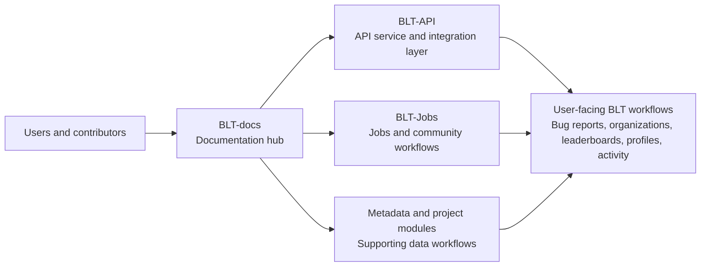

# BLT platform architecture

## Purpose

This page describes the documentation-level architecture view for contributors. It explains how major BLT modules relate to each other without replacing repository-owned architecture documents, implementation notes, or deployment runbooks.

## Platform modules

| Module | Role | Documentation-level notes |
| ------ | ---- | ------------------------- |
| BLT-docs | Documentation hub | MkDocs site deployed as static documentation through Cloudflare Workers Static Assets. |
| BLT-API | API service and platform integration layer | Current platform direction references Python on Cloudflare Workers and Cloudflare D1 where those are used by the API repository. Confirm exact implementation details in BLT-API before changing code. |
| BLT-Jobs | Jobs/community portal and automation workflows | Community and jobs-related workflows, including static site or job data patterns where the repository uses them. |
| Metadata/projects modules | OWASP project metadata and supporting data workflows | Supporting modules for OWASP project metadata, project catalogs, repository discovery, and related data generation. |
| User-facing BLT workflows | Product workflows | Bug reports, organizations, leaderboards, profiles, and activity pages documented for users elsewhere in this site. |

## High-level flow

## API access and identity concepts

BLT documentation may refer to API-key gates and user identity concepts in the same area, but they are not the same thing.

An API access gate such as `X-BLT-API-Key` controls whether a client may call protected API surfaces. It should be documented as an access-control concept, not as a user account or session identity.

User identity concepts such as sessions or JWTs represent an authenticated user or user-related authorization flow. When documenting identity, explain what a user can do and where the identity is established, but do not claim exact token formats, lifetimes, or validation behavior unless the owning repository documents them.

## Documentation boundaries

BLT-docs should explain concepts, contributor workflows, and stable cross-repository guidance. Repository README files should keep quick-start and repository-specific commands close to the code. Agent-specific context belongs in approved agent files or developer documentation, not in human-facing README content unless maintainers explicitly request it.

When implementation details change, update the owning repository first or in the same merge request. Then update BLT-docs with stable contributor guidance.

## Related pages

- [Contributing](contributing.md)
- [Documentation Maintenance](docs-maintenance.md)
- [Deployment](deployment.md)
- [BLT-API](../repositories/blt-api.md)
- [BLT-Jobs](../repositories/blt-jobs.md)
