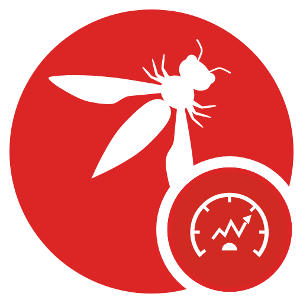

# OWASP Bumper

**Live site:** [https://bumper.owaspblt.org/](https://bumper.owaspblt.org/)<br>
**Source code:** [https://git.owaspblt.org/BLT/tree/blt-owasp-bumper](https://git.owaspblt.org/BLT/tree/blt-owasp-bumper)

<p align="center"></p>

Find idle repositories in the [OWASP GitHub organization](https://github.com/OWASP) and nudge their
maintainers with a reminder issue, one at a time or in batches.

## Using it

- **Best to bump** is the default order. Each repository gets a score: importance × staleness ×
  noise. Importance counts stars, forks, open issues and PRs, OWASP projects and their level, and
  stars that keep arriving after the last push. Staleness grows with the years since the last
  commit by a person: bot commits (dependabot, GitHub Actions…) don't count as upkeep. Noise pushes down repos a reminder won't help: forks,
  templates, empty repos, ones whose description says they moved or are defunct (archive those
  instead), `-old` / `-backup` copies, near-duplicate siblings (`crackme-a1`, `-a2`…; only the
  best-scoring one leads), repos with an open reminder issue, and ones you've bumped. The clearest
  cases are collapsed as *Low-signal* under the table, with a count of each kind. Each row's score is
  coloured by tier (top tenth solid red, top quarter tinted), with a short note under it only when
  it flags something the other columns don't (fork, moved, duplicate, PRs waiting…); hover for the
  full breakdown. Columns pack two facts each: type with language and year, stars with forks, last
  push with its date, last bump with its replies. The plain orders (most idle,
  stars, issues, name, age) are in the sort menu and the column headers.
- **Last bump**: each repository's latest reminder issue, open or closed (titled "Repository
  Activity Reminder", Bumper's earlier title, or "still maintained"). It shows how many times the repo
  has been bumped, how long ago, the issue number, and its replies, with the last reply linked (hover
  for who and when). Forms you open here count as your own bumps. The *Last bump* filter picks open,
  no reply yet, replied, closed or never bumped; *Recently bumped* sorts by it. A reminder opened
  less than a year ago takes the place of the Bump button, so nobody files a second one; one closed
  in the last year pushes the repo down.
- **Filter** by activity (last commit by a person, else last push: active < 1 year, idle 1, 2, 3 or 5+ years), type, language,
  creation year, archived, and whether you've opened a form for it already. Search
  covers names, descriptions and topics. The summary tiles are activity presets with live counts.
  The filters are in the URL, so a filtered view can be shared.
- **Select** rows with the checkboxes (shift-click ticks a range), the header box, or
  *Select all N matching*. The bar at the bottom shows the count, including selected rows the
  current filters hide.
- **Open issue forms** opens GitHub's new-issue form on each selected repository, prefilled with a
  short reminder that names the last commit. You review and submit each one, signed in as yourself.
  Browsers allow only a few tabs per click, so forms open 10 at a time: click again for the next
  batch. If the browser blocks them, the page says so and keeps the rest selected; allow pop-ups
  for the site and click again.
- **Copy checklist** copies the selection as a Markdown task list with each repository's reminder
  link, for a tracking issue or for working through later.

Where reminders go: always the repository's own GitHub issue tracker (`github.com/OWASP/<repo>/issues/new`),
opened and submitted by a person under their own account. Nothing goes to forks' parents, to BLT or
to a shared inbox.

Types come from what GitHub shows, not from OWASP project status:

| Type | Rule |
| --- | --- |
| Project | the repo's homepage (*About → Website*) is its owasp.org project page (`owasp.org/projects/<slug>` or `owasp.org/www-project-<slug>`), or the owasp.org inventory names it as a project's code; the pill links to the project page |
| Project site | an owasp.org project website repo (`www-project-*`) |
| Chapter | a chapter website repo (`www-chapter-*`) |
| Repo | anything else; a maintainer links it by setting the homepage |

Forms you open are remembered in your browser (`localStorage`, a list of times per repo) as
*Form opened by me*; Bumper can't see whether you submitted them. Within 7 days of a form opened
here, or of a reminder issue, Bumper asks before opening another (the Bump button says *Wait*;
batches hold those repos back with an *Open them anyway* button). Archived repositories, ones with
issues turned off and ones with the topic `bumper-ignore` can't be bumped. Every reminder links to
the page's *Why am I seeing this?* section (`#why`), which tells maintainers how the mapping works,
how to link their repo to their project, and how to opt out.

Why tabs and not the API: the repositories are OWASP's, on GitHub, and Bumper has no GitHub
credentials of its own. A prefilled form lets each reminder go out under the volunteer's own
account, after they've read it, with no token to store.

## Suggested projects to archive (`/sweep`)

[bumper.owaspblt.org/sweep](https://bumper.owaspblt.org/sweep) lists OWASP projects that look
finished, for the Project working group to archive or mark inactive. It covers every project in the
[owasp.org inventory](https://owasp.org/projects/) plus the active `www-project-*` repositories it
doesn't list, and gives each one a score from 0 to 100 with the evidence behind every point:

- **Against** (adds points): years since the last commit by a person or release on its code
  repository (15 a year, up to 60); the repository owasp.org links is archived (60), missing (40) or
  absent (25); its description says deprecated / moved (30); its owasp.org page is still the
  www-project template (20); a reminder issue unanswered for a month (20) or closed without a reply
  (10); three or more contributors' pull requests untouched for a year (8).
- **For** (takes points away): a commit in 90 days (−30), a release in the last year (−25), a
  maintainer's reply to a reminder (−15), 1,000+ stars (−10).

Archive at 70, Mark inactive at 45, Ask leaders first at 25. Flagship and Production projects, and
archived links whose project website was edited this year, are held at Ask leaders first. Projects
no longer in the inventory get *Archive website repo* (idle) or *Active, not listed*. The page
exports the list as a Markdown checklist grouped by suggestion (with the evidence) or as CSV. The
scoring lives in `public/sweep.js`, tested under Node like `bumper.js`.

`generate_sweep.py` (standard library, no GitHub requests) builds `public/data/sweep.json` after
`generate_repo_list.py`, joining Bumper's repositories with the
[OWASP Project Matrix](https://projects.owaspblt.org/)'s `repo_status.json` and `open_prs.json`.

## How it works

| Piece | What it does |
| --- | --- |
| `generate_repo_list.py` | Writes `public/data/repos.json` for every repo in the org (standard library only). Repositories an owasp.org project names as its code or website are linked to it (title, level) through the Project Matrix's `repo_status.json`, so a project's code repo is a *Project* without a homepage set; `template_page` marks a www-project site whose `index.md` is still the template. With `GITHUB_TOKEN` it uses one GraphQL query per 25 repos (about 60 requests, ~5 minutes; a page GitHub times out is retried at half the size): stars, forks, open issues and PRs, the last 5 commits (so bot commits can be skipped), topics and `index.md` front matter. Before, it made about 4 REST requests per repo (~5,800). Without a token it falls back to the REST repo list (about 15 requests; no PR counts, last commit or front matter). Either way it then finds reminder issues and their last replies (two searches plus one request per reminder with replies). |
| `generate_sweep.py`, `public/sweep.html`, `public/sweep-app.js`, `public/sweep.js` | The suggested-archive list (above). |
| `public/index.html`, `public/app.js`, `public/bumper.js`, `public/bumper.css` | The static page. `bumper.js` holds the filtering, sorting and link logic (tested under Node); `app.js` draws the page. It uses the shared OWASP BLT bar (`blt-nav.js`) for the header and theme toggle. |
| `worker/index.js` | Serves `/data/repos.json` and `/data/sweep.json` from Workers KV, falling back to the committed copy in `public/data/`. Everything else is static. |
| `scripts/refresh-kv.sh` | Regenerates the data and the sweep and writes them to KV, unless it lists fewer than half as many repositories as before. Run daily by `.forkmesh/blt-owasp-bumper--generate-repo-list.yml` (monorepo root). |

## Development

```bash
python3 generate_repo_list.py                       # refresh public/data/repos.json (no token needed)
npx wrangler@4 dev --config wrangler.toml           # http://localhost:8787
node --test 'test/*.test.mjs'                       # tests (or scripts/ci/test.sh blt-owasp-bumper from the root)
```

Deploy from the monorepo root with `scripts/deploy.sh blt-owasp-bumper` (the Deploy workflow does
this when the folder changes).

## Contributing

Issues and pull requests go to the BLT forge: [issues](https://git.owaspblt.org/BLT/issues),
[pull requests](https://git.owaspblt.org/BLT/pulls). Part of [OWASP BLT](https://owaspblt.org/).

## License

MIT, see [LICENSE](LICENSE).
