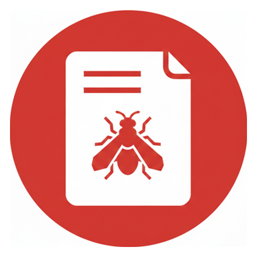

# OWASP BLT — Bug Reporting Platform

**Live Site:** [https://pages.owaspblt.org/](https://pages.owaspblt.org/)<br>
**Source Code:** [https://git.owaspblt.org/BLT/BLT-Pages](https://git.owaspblt.org/BLT/BLT-Pages)

<p align="center"></p>

[](https://owasp.org/www-project-bug-logging-tool/)
[](https://www.gnu.org/licenses/agpl-3.0)
[](https://pages.owaspblt.org/)

Community-powered bug-reporting platform hosted from `public/` on Cloudflare, part of the
[OWASP Bug Logging Tool (BLT)](https://owasp.org/www-project-bug-logging-tool/) project.

---

## Features

| Feature | Description |
|---|---|
| 🐛 **Public bug reports** | 404/500 errors, functional, performance, typos, design, IP violations |
| 🕶️ **Anonymous reporting** | Submit via [BLT-API](https://blt.owasp.org/api) — no account required |
| 🔒 **Security vulnerabilities** | Zero-log, zero-tracking via [BLT-Zero](https://zero.owaspblt.org) |
| 🏆 **Leaderboard** | Generated from the blt-pages bug reports on git.owaspblt.org |
| 🗳️ **Leaders** | Leadership nominations are forge issues; votes are the forge's issue votes |

---

## Tech Stack

- **Pure HTML + Tailwind CSS** (CDN) — no build step
- **Font Awesome** (CDN)
- **ForkMesh Actions** on git.owaspblt.org for leaderboard generation
- **Cloudflare Workers Static Assets** serving `public/`, with the leaderboard pages and data in Workers KV
- **BLT-API** for anonymous report submission

---

## Local Development

No build step required — open the HTML files directly in a browser, or use any
static file server:

```bash
# Python
python -m http.server 8080 --directory public

# Node
npx serve public
```

---

## Leaderboard and leaders data

`.forkmesh/blt-pages--update-leaderboard.yml` runs `scripts/refresh-kv.sh` when a blt-pages or
nomination issue changes, when the generator or a pre-rendered page changes, and daily at 05:11 UTC.
`scripts/generate_leaderboard.py` reads the issue ledger of the BLT monorepo on git.owaspblt.org
(`scripts/forkmesh/ledger.py`, anonymous):

- **bug reports**: issues labelled `bug` that belong to blt-pages (label `blt-pages` or a `[blt-pages]`
  title prefix). Reporters, commenters, domains (from the `### URL` field) and the three newest open
  reports. Forge issues have votes, not emoji reactions; votes show as +1.
- **leaders** (`leaders.html`): elections and past winners are curated in `public/data/leaders.json`.
  Nominations are issues titled `[NOMINATION] ...` (the page copies the text and opens a new issue);
  a maintainer adds the label `accepted`. Votes are the issue's Vote button on git.owaspblt.org, one per
  account, counted once per role. The project list comes from `scripts/routing/projects.tsv`.

The script writes `data/leaderboard.json` and `data/leaders.json` and pre-renders `index.html` and
`leaderboard.html`; the job writes those four files to the Worker's KV and commits nothing.
`worker/index.js` serves them from KV and falls back to the committed copies.

The Playwright tests in `.gitlab-ci.yml` are not run on the forge runner (no Chromium). Unit tests:
`scripts/ci/test.sh blt-pages`.

---

## Issue Template

Bug reports are issues on [git.owaspblt.org](https://git.owaspblt.org/BLT/issues/new) with the title prefix
`[blt-pages]` and the labels `bug` and `blt-pages`. The forge has no issue templates; copy the body from
[`issue-templates/bug.md`](issue-templates/bug.md). The project's issues are listed at
<https://git.owaspblt.org/BLT/issues?label=blt-pages>.

---

## License

[GNU Affero General Public License v3.0](LICENSE) — OWASP Foundation &amp; BLT Contributors.
