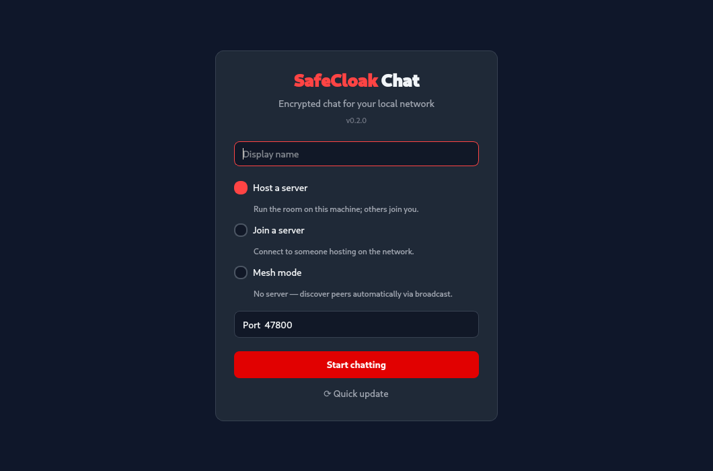
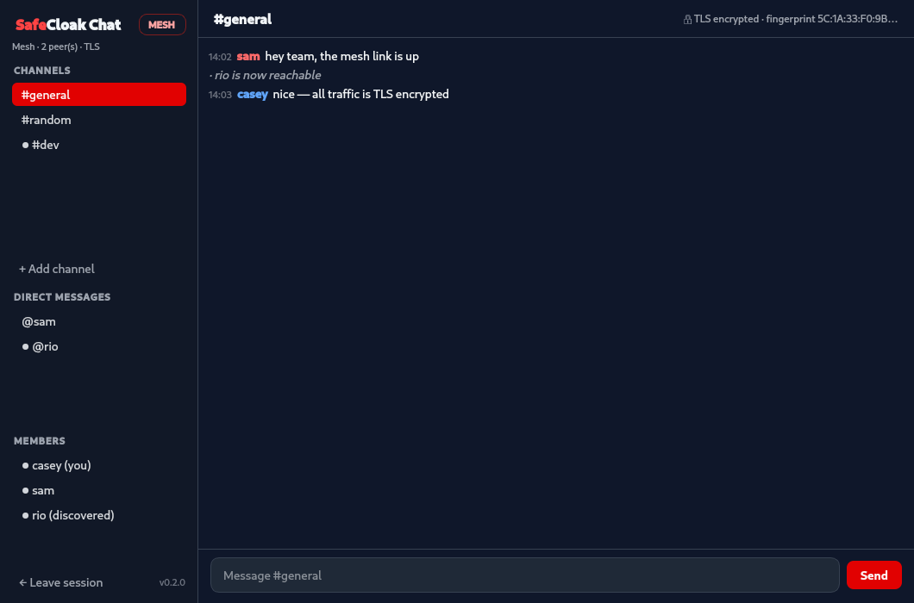

# SafeCloak

A Qt 6 desktop chat app for your local network, styled to match the
BLT-SafeCloak theme. Think Slack, but self-organizing on your LAN with no
internet dependency: channels, a member list, and TLS-encrypted traffic.




## Mesh-only chat

SafeCloak has no host/join mode. Every node announces itself over UDP
(multicast + broadcast + loopback), publishes its usable local IPv4 addresses,
dials every discovered peer immediately, and floods messages through the mesh
with duplicate suppression. Nodes appear in the member list as soon as they
are discovered, then lose the
`(discovered)` note once the encrypted peer link is live.

You get Slack-style channels (`#general` and `#random` by default, "+ Add
channel" creates more and propagates them to everyone) and direct messages:
click a member in the sidebar to start a one-to-one chat. DMs go over the
direct TLS link when one exists and are otherwise routed through intermediate
nodes, which forward but never display them.
If a peer is visible but its TCP listener times out, SafeCloak keeps retrying
the direct TLS link and uses the already-working LAN discovery socket as a
fallback message path so nearby peers can still chat.

## Building

Requires Qt 6.4+ (Widgets, Network), CMake 3.16+, a C++17 compiler, and the
`openssl` CLI at runtime (used once to generate the node certificate).

```sh
cd client
cmake -B build -DCMAKE_BUILD_TYPE=Release
cmake --build build -j
./build/safecloak
```

Or use the helper script: `./run.sh` builds and launches, `./run.sh clean`
clears the build cache, `./run.sh rebuild` does both, and `./run.sh test`
runs the headless tests.

To install without a checkout, the website serves a one-line installer that
grabs the latest CI build (or compiles from source):

```sh
curl -fsSL https://<site>/install.sh | bash
```

### Tests

A headless smoke test covers mesh discovery, bidirectional roster visibility,
channel propagation, mesh flooding, direct messages, and cross-IP loopback
simulation (built by default). Test nodes use a private discovery tag, so
they do not appear in a running SafeCloak window on the same machine or
LAN:

```sh
QT_QPA_PLATFORM=offscreen ./build/safecloak-tests
```

## How encryption works (and its limits)

- Every mesh peer link is TLS 1.2+. Nothing is ever sent in plaintext over TCP.
- On first run each installation generates a self-signed RSA-2048
  certificate (stored under the per-user app data directory), which it
  presents on every inbound connection. Its SHA-256 fingerprint is shown in
  the chat header.
- Because certificates are self-signed, peers are **encrypted but not
  authenticated**: a machine on your LAN could impersonate a mesh node (no
  protection against an active man-in-the-middle on the local network).
  Compare fingerprints out-of-band if that matters for your threat model.
- UDP discovery announcements contain only the display name, a random node id,
  and a port — never message content.

## Network details

- Mesh discovery uses UDP ports 45454–45463 and multicast group
  239.255.43.21; each instance on a machine takes the next free port, so up
  to 10 instances per host can participate. Announcements go out on every
  network interface (multicast + each interface's directed broadcast), so
  machines with docker bridges or VPNs still discover peers on the LAN.
- Mesh TLS listeners prefer TCP ports 45464–45473 (falling back to an
  ephemeral port). If peers see each other as "(discovered)" but never
  connect, allow TCP 45464–45473 and UDP 45454–45463 through your firewall.
- The sidebar status shows your local IPs plus the active UDP and TCP ports.
  The message pane logs discovery, dial attempts, timeouts, and socket/TLS
  errors so you can see exactly where a peer link is failing.
- When the app was built from a local checkout, the home screen shows a
  "Quick update" button that pulls the latest version, rebuilds, and
  relaunches the app.
- Every node dials every discovered peer immediately and rotates through the
  peer's advertised IP addresses when a dial times out. If both sides dial at
  once, duplicate links are resolved deterministically.
