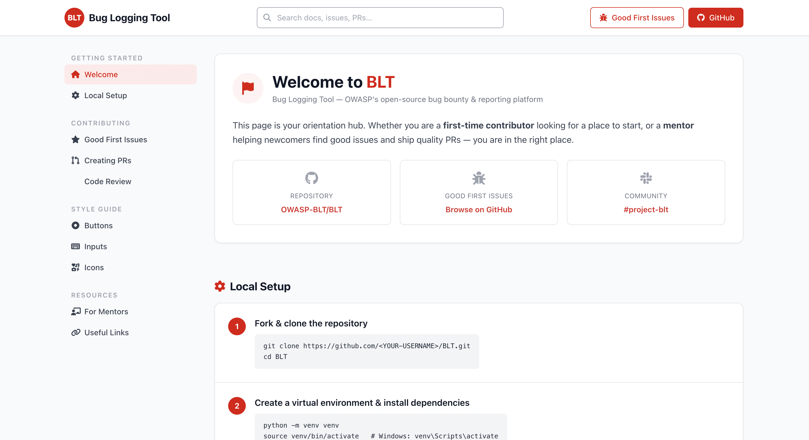

# 🚀 BLT Contributor Start Page

<p align="center">
  <b>Modern Contributor Dashboard for OWASP BLT</b><br/>
  <i>Helping developers onboard, contribute, and collaborate efficiently</i>
</p>

<p align="center">
  
  
  
</p>

---

## 📌 Overview

A beautifully designed **Contributor Start Page UI** for the **Bug Logging Tool (BLT)** project.

This dashboard helps:

* 🧑‍💻 First-time contributors get started
* 🧑‍🏫 Mentors guide contributors
* 🌍 Open-source communities collaborate better

---

## ✨ Features

* 📚 Contributor onboarding guide
* 🐞 Good first issues section
* ⚙️ Local setup instructions
* 🔀 Merge request workflow
* 🔍 Code review guidelines
* 🎨 UI Style Guide (Buttons, Inputs, Icons)
* 🌙 Dark mode support
* 📱 Fully responsive layout
* ⚡ Smooth scrolling + active sidebar

---

## 📸 Screenshots

<p align="center">
  
</p>

---

## 🛠️ Tech Stack

* HTML5
* Tailwind CSS (CDN)
* Font Awesome
* Vanilla JavaScript
* Cloudflare Workers Static Assets

---

## ⚡ Getting Started

### 📦 Installation

1. Clone the repository:

   ```bash
   git clone https://gitlab.com/shiva119127/blt-contributor-page.git
   ```

2. Navigate to the project directory:

   ```bash
   cd blt-contributor-page
   ```

3. Start the local Cloudflare Workers development server:

   ```bash
   wrangler dev
   ```

4. Deploy to Cloudflare Workers:

   ```bash
   wrangler deploy
   ```

---

## ▶️ Usage

1. Open the webpage
2. Navigate via sidebar
3. Follow onboarding steps
4. Explore contribution guide

---

## 📁 Project Structure

```text
.
├── public/
│   └── index.html
├── wrangler.toml
└── README.md
```

---

## 🎯 Sections Included

* 🏠 Welcome Dashboard
* ⚙️ Local Setup
* ⭐ Good First Issues
* 🔀 Creating MRs
* 🔍 Code Review
* 🎨 Style Guide
* 🔗 Useful Links

---

## 🤝 Contributing

Contributions are welcome!

```bash
# Fork the repo
# Create your branch
git checkout -b feature/your-feature

# Commit changes
git commit -m "feat: add new feature"

# Push & MR
git push origin feature/your-feature
```

---

## 🔮 Future Improvements

* 🔗 GitLab API integration
* 👤 Authentication system
* 📊 Contributor analytics
* 🌐 Multi-language UI toggle

---

## 📜 License

MIT License © 2026

---

## ⭐ Support

If you like this project:

👉 Give it a ⭐ on GitLab
👉 Share with developers
👉 Contribute 🚀

---

<p align="center">
  Made with ❤️ for Open Source
</p>
