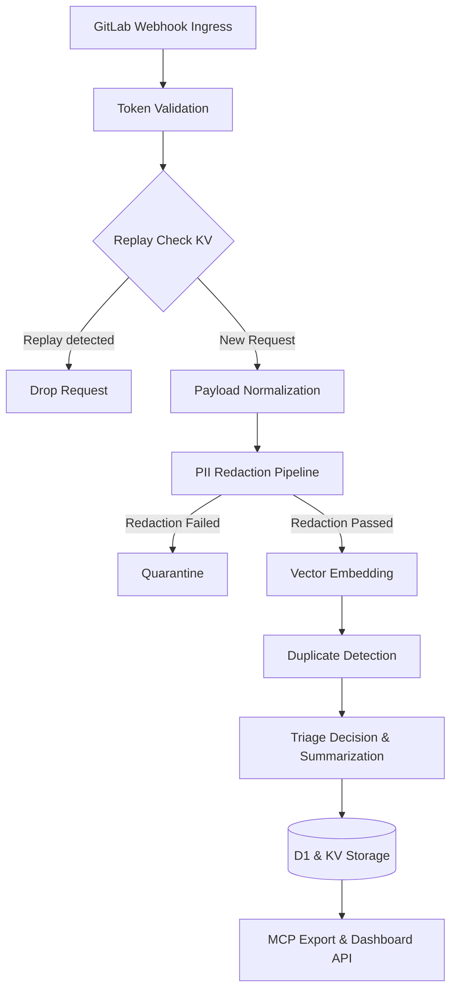
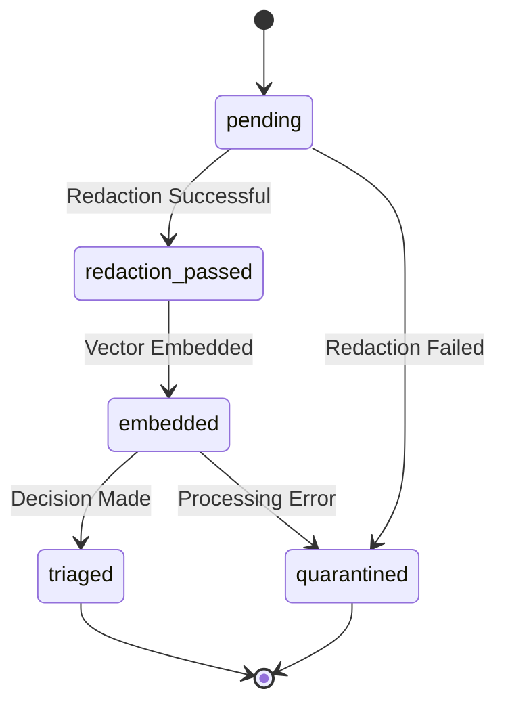

# OWASP BLT-Toasty Architecture

## 1. System Overview
OWASP BLT-Toasty is a serverless application built on the Cloudflare Workers Python runtime (Pyodide/Workerd, `compatibility_flags = ["python_workers"]`). It acts as an intelligent triage and duplicate detection pipeline for GitLab issues. The system ingests incoming webhooks, applies fail-closed PII redaction, detects duplicates using vector similarity, and provides a multi-provider LLM-powered summarization and triage decision. It features stateful conversational capabilities via Durable Objects, Model Context Protocol (MCP) exports, and a Shadow Mode for validating ML predictions against ground truth without affecting production data.

## 2. Data Flow Diagram

## 3. Component Breakdown

The primary entry point is `worker.py` handling `on_fetch` for HTTP requests and `on_scheduled` for cron tasks.

- **`worker.py` Routes:**
  - `GET /` - Root landing
  - `GET /health` - Health check
  - `POST /api/review` - Code review
  - `POST /webhook/gitlab` - Webhook ingestion
  - `GET /api/status` - Status
  - `GET /mcp/triage/{id}` - MCP export
  - `GET /triage/{id}/rationale` - Rationale
  - `GET /admin/dashboard` - Dashboard (JWT auth, role=admin)
  - `GET /admin/shadow-report` - Shadow report (JWT auth)
  - `/conversations/*` - Durable Object conversations (JWT auth)

### Source Modules

- **`src/webhook_handler.py`**: Handles GitLab webhook ingestion. Verifies `X-Gitlab-Token`, performs replay checks using `X-Gitlab-Event-UUID` via KV, normalizes payloads for Issue Hook and Note Hook, performs SHA-256 body hashing, and inserts into the D1 `triage_events` table.
- **`src/redaction_engine.py`**: A fail-closed PII redaction pipeline. Events are quarantined if redaction fails.
- **`src/native_recognizers.py`**: Regex-based recognizer engine utilizing longest-match-first strategy and a deny-list for CVE/CWE/OWASP IDs. It detects 17+ entity types (e.g., EMAIL_ADDRESS, IP_ADDRESS, JWT_TOKEN, AUTH_TOKEN, AWS_ACCESS_KEY, AWS_SECRET_KEY, AWS_ARN, GITHUB_TOKEN, API_KEY, API_TOKEN, DOMAIN, HOSTNAME, DB_CONNECTION, MONGODB_URI, USERNAME, PASSWORD, CREDIT_CARD, PRIVATE_KEY, BEARER_TOKEN, MD5_HASH) with a confidence threshold of 0.70.
- **`src/markdown_preprocessor.py`**: Extracts plain text from markdown for PII scanning.
- **`src/duplicate_detector.py`**: Performs vector similarity duplicate detection using Vectorize.
- **`src/vectorize_client.py`**: Cloudflare Vectorize integration client configured for 384-dimension cosine metric.
- **`src/embedding_client.py`**: FastEmbed text embedding client.
- **`src/state_machine.py`**: Manages the triage pipeline states.
- **`src/summarizer.py`**: Provides LLM-powered issue summarization and CWE labeling.
- **`src/llm_router.py`**: Handles multi-provider LLM routing.
- **`src/mcp_export.py`**: Model Context Protocol (MCP) export endpoint.
- **`src/rationale_builder.py`**: Generates structured rationale for triage decisions.
- **`src/shadow_pipeline.py`**: Validates predictions in shadow mode by running a dual-run pipeline and comparing predictions against ground truth.
- **`src/dashboard.py`**: Aggregates queries for the dashboard.
- **`src/auth.py`**: RS256 JWT verification (`iss: owasp-blt-service`, `aud: toasty-mcp`).
- **`src/durable_objects.py`**: Implementations for `ConversationDO` and `RateLimiterDO`.
- **`src/errors.py`**: Defines the custom error hierarchy.
- **`src/gitlab_linker.py`**: Handles GitLab API integrations.

## 4. Shadow Mode Architecture

Shadow Mode provides a safe environment to validate ML models and pipeline logic in production without mutating production state. When `SHADOW_MODE=true`, the triage pipeline runs parallel predictions. The actual triage operations proceed as normal, while the shadow pipeline evaluates the data independently. Results of these shadow runs are stored in the `shadow_predictions` D1 table.

An hourly `on_scheduled` cron job (dispatched by the blt-cron Worker via `POST /__scheduled`) triggers the shadow mode validation. This mechanism compiles weekly summaries to track model performance, aiming for a target accuracy of >= 80% against ground truth data before deploying models to active production triage.

## 5. Data Storage

The application heavily utilizes the Cloudflare developer data platform ecosystem:

- **D1 Database (`toasty-db`)**: A relational SQL database containing tables for `triage_events`, `triage_summaries`, `duplicate_candidates`, `redaction_audit`, `conversation_archive`, `rate_limiter_events`, `shadow_predictions`, and `rationale`.
- **Vectorize (`toasty-embeddings`)**: A vector database using 384-dimensional embeddings and the cosine metric for semantic similarity searches in duplicate detection.
- **KV Storage (`TOASTY_KV`)**: Key-Value store primarily used for replay protection. It deduplicates `delivery_id` UUIDs with an 86400s (24 hours) TTL.
- **Durable Objects**:
  - `ConversationDO`: Manages stateful, multi-turn conversations.
  - `RateLimiterDO`: Implements sliding window rate limiting.
- **Analytics Engine (`toasty_telemetry`)**: Stores and processes application telemetry data.

## 6. Triage Pipeline State Machine

