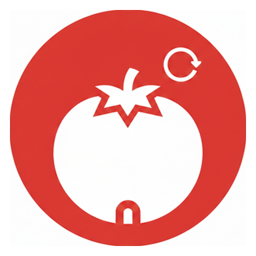

# BLT-Tomato

**Live Site:** [https://tomato.owaspblt.org/](https://tomato.owaspblt.org/) 
**Source Code:** [https://git.owaspblt.org/BLT/BLT-Tomato](https://git.owaspblt.org/BLT/BLT-Tomato)

Scripts related to projects mainly for high level OWASP project management
1) Funding site served from `public/`: every OWASP project with a `.github/FUNDING.yml`, its own
   funding links (GitHub Sponsors, Open Collective, Patreon, custom pages, ...) and its top
   contributors who take GitHub Sponsors. owasp.org/donate links are shown apart: since OWASP's new
   website they fund the Foundation in general; to give to a project through OWASP, donors contact
   the Foundation.
2) Tomato 1000 at `/1000` (`public/1000.html`): a drive to get 1,000 developers, from any project,
   to $1,000 a month in GitHub Sponsors. Any developer joins by adding their GitHub username to
   [`tomato1000.txt`](tomato1000.txt); the top contributors of every OWASP repository the scraper
   scans (and of BLT) are in from the start. The scraper keeps those with GitHub Sponsors turned on
   and writes `tomato1000.json` with each one's public sponsor count, Sponsors goal and top
   repositories (amounts are private; a monthly-dollar goal is the only public progress). The page
   reads that file.

## Cloudflare and the weekly refresh (Workers KV)

`wrangler.toml` deploys a Worker (`worker/index.js`) with `public/` as its static assets. Deploy
with `scripts/deploy.sh blt-tomato` from the monorepo root; test with `scripts/ci/test.sh blt-tomato`.

`.forkmesh/blt-tomato--scrape_funding.yml` runs every Friday at 18:00 UTC on git.owaspblt.org (also
on demand, and when the scraper changes). It runs `scripts/refresh-kv.sh`, which runs
`.github/scripts/funding/owasp_funding_yml_scraper.py` with `OUTPUT_DIR=public` and writes
`index.html`, `project_repos_links.json` and `tomato1000.json` into the Worker's KV namespace, unless the new list
has fewer than half as many projects as before. Nothing is committed and nothing is redeployed.
The Worker serves `/`, `/index.html` and `/project_repos_links.json` from KV and falls back to the
committed copies in `public/` (no longer updated) while KV has none. The workflow needs the
Actions secrets `GH_API_TOKEN`, `CLOUDFLARE_API_TOKEN` (Workers KV Storage: Edit) and
`CLOUDFLARE_ACCOUNT_ID`. Run it by hand from the Actions page of https://git.owaspblt.org/BLT
(workflow_dispatch).
